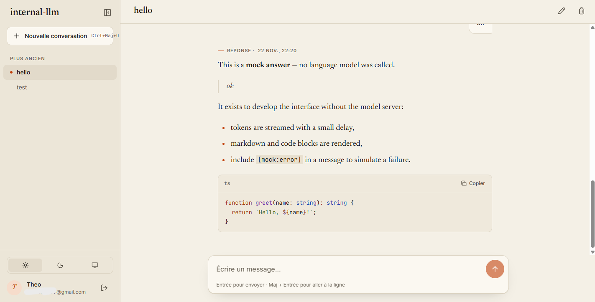
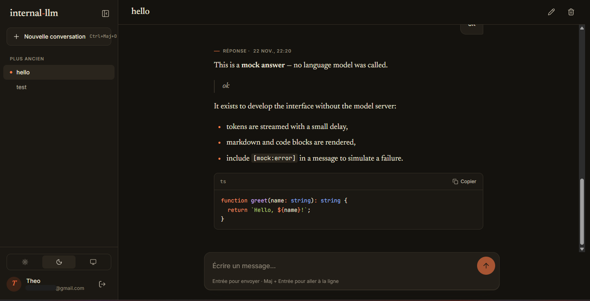
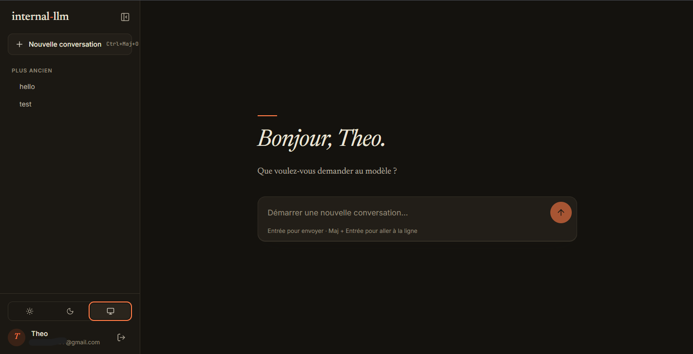
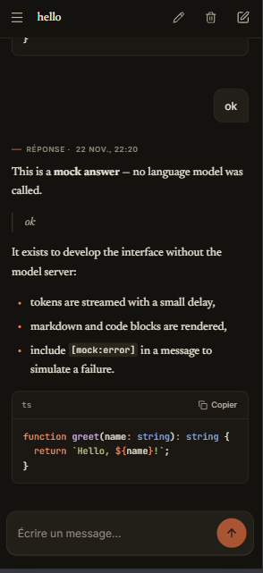

# internal-llm

Web chat interface for a self-hosted open-source LLM.

> 🚧 Work in progress — the full documentation (architecture, getting started, configuration,
> adding an LLM provider) lands with the end of milestone 1.

## Screenshots

<table>
  <tr>
    <td></td>
    <td></td>
  </tr>
  <tr>
    <td></td>
    <td></td>
  </tr>
  <tr>
    <td colspan="2" align="center"></td>
  </tr>
</table>

## Repository layout

| Folder | Content                                                      |
| ------ | ------------------------------------------------------------ |
| `api/` | NestJS 12 API (Prisma 7, PostgreSQL, JWT cookie auth, SSE)   |
| `web/` | React + Vite front-end (TanStack Query, Tailwind, shadcn/ui) |

`api/` and `web/` are two independent npm projects: each one installs, runs, tests and builds on
its own, and has its own Dockerfile. They only communicate over HTTP.

At the root: `docker-compose.yml` (the whole app in containers), `docker-compose.dev.yml`
(PostgreSQL only, for local development) and `.env.example` (variables for both).

## Running with Docker

Prerequisites: Docker with Compose, and Node (any recent version, only used to generate the
secrets). The app runs with the `mock` LLM provider by default (fake streamed answers, no model
server needed).

1. Create your `.env`:

   ```sh
   cp .env.example .env
   ```

2. Fill in the two required secrets, `POSTGRES_PASSWORD` and `JWT_SECRET`. They are empty in
   `.env.example` on purpose: Compose refuses to start without them. Run this command twice
   (it works the same in any shell) and paste one result for each:

   ```sh
   node -e "console.log(require('crypto').randomBytes(32).toString('hex'))"
   ```

3. Start the stack:

   ```sh
   docker compose up -d --build
   ```

The app is served at http://localhost:8080 (`WEB_PORT` in `.env`). There is no public sign-up:
create the first user from the API container (interactive: email, name, administrator or not,
hidden password):

```sh
docker compose exec api node dist/cli/create-user.js
```

To give the admin role to an existing account (see [Roles and access](#roles-and-access)):

```sh
docker compose exec api node dist/cli/promote-user.js --email alice@example.com
```

What runs:

| Service    | Image                                                            | Role                                                                                                                                                                          |
| ---------- | ---------------------------------------------------------------- | ----------------------------------------------------------------------------------------------------------------------------------------------------------------------------- |
| `postgres` | `postgres:18.7-alpine`                                           | Database, kept in the `postgres-data` volume. Not reachable from the host.                                                                                                    |
| `migrate`  | `api/Dockerfile`, `migrate` target (Node, Debian slim, non-root) | One-shot: applies the pending migrations (`prisma migrate deploy`) on every `up`, then exits. Starts once the database is healthy.                                            |
| `api`      | `api/Dockerfile` (Node, Debian slim, non-root)                   | Serves the API. Starts once the database is healthy and `migrate` has succeeded; health check on `/api/health`. Does not contain the Prisma CLI, hence the separate service.  |
| `web`      | `web/Dockerfile` (Vite build, unprivileged Nginx, non-root)      | Serves the client and proxies `/api` to the API, without buffering on the streamed answers route. Falls back to `index.html` for client-side routes. The only published port. |

Everyday commands:

```sh
docker compose logs -f api        # follow the API logs
docker compose logs migrate       # what the last migration run did
docker compose ps                 # status and health of each service
git pull && docker compose up -d --build   # update (migrations run on start)
docker compose down               # stop (add -v to also delete the database volume)
```

Every variable of `.env.example` is passed to the containers. Set `COOKIE_SECURE=true` once the
app is served over HTTPS.

### Purging old LLM calls

Every LLM call is recorded in the `llm_calls` table (timings, outcome, no text). So that it does
not grow forever, the API deletes the records older than `LLM_CALL_RETENTION_DAYS` (90 by
default, minimum 1) every day at 03:00 UTC, and logs how many rows it deleted. Only `llm_calls`
is purged: conversations and messages are never deleted.

To run the purge at once (it also accepts `--days <n>` to override the retention):

```sh
docker compose exec api node dist/cli/purge-llm-calls.js    # Docker
npm run llm-calls:purge                                     # local development, from api/
```

With PowerShell, `npm run` swallows `--days`: set `$env:LLM_CALL_RETENTION_DAYS` instead.

### Published images

Every merge to `main` publishes three images to GitHub Container Registry
(`.github/workflows/publish.yml`), for `linux/amd64` only:

| Image                                          | Content                                                                  |
| ---------------------------------------------- | ------------------------------------------------------------------------ |
| `ghcr.io/theo-spetebroot/internal-llm-api`     | The API                                                                  |
| `ghcr.io/theo-spetebroot/internal-llm-migrate` | One-shot job that applies the database migrations, to run before the API |
| `ghcr.io/theo-spetebroot/internal-llm-web`     | The web client served by Nginx                                           |

Tags: `latest` (the last merge to `main`) and `sha-<short commit hash>` (that exact commit: use
it to pin a version). The three images are always built from the same commit, so `latest` and a
given `sha-…` tag always form a consistent set. The `migrate` image is built from `api/Dockerfile`
(`migrate` target): the API image no longer contains the Prisma CLI, so pulling a new API version
means running the matching `migrate` image first, as `docker-compose.yml` does.

```sh
docker pull ghcr.io/theo-spetebroot/internal-llm-api:latest
docker pull ghcr.io/theo-spetebroot/internal-llm-migrate:latest
docker pull ghcr.io/theo-spetebroot/internal-llm-web:latest
```

Pulling needs no login once the packages are public (package settings → Danger Zone → Change
visibility: a one-time step after the first publish, since new packages are private).
`docker-compose.yml` still builds from the sources; a Compose file that pulls these images comes
with the VPS deployment.

## API contract

The API is the source of truth: Zod schemas validate requests and generate the Swagger
document. `npm run openapi:export` (in `api/`) writes it to `api/openapi.json`, which is
committed. The web client generates its TypeScript types from that file with
[openapi-typescript](https://openapi-ts.dev/) (`npm run gen:api` in `web/`, output committed in
`web/src/api/schema.d.ts`) and calls the API through [openapi-fetch](https://openapi-ts.dev/openapi-fetch/).
CI fails when either generated file is out of date.

### Streaming answers (SSE)

`POST /api/conversations/:id/messages` answers with Server-Sent Events, each `data` being a JSON
`ChatEvent`: `start` (saved user message, conversation possibly auto-titled), `delta`* (pieces of
the answer), then `done` (saved answer) or `error` (code, partial answer saved as interrupted).
Comment lines (`: ping`) keep proxies from closing a silent connection.

The Zod schemas live in `api/src/chat/chat.schemas.ts`. The web client keeps a copy in
`web/src/api/chat-events.ts` and validates every event it receives; a compile-time check fails
as soon as that copy and the generated `ChatEvent` type diverge.

### Token usage

Every assistant message stores `promptTokens` and `completionTokens` (both `null` on user
messages), with `tokensEstimated` telling where they come from. Until the model server reports
real figures they are estimated at about four characters per token (`estimated: true`). A
provider can report its own usage — `chat()` resolves to `{ text, usage? }` and `chatStream()`
may return the usage when the stream ends — and `LlmService` then prefers it
(`tokensEstimated: false`). A partial answer is always estimated.

### Roles and access

Every account has a role: `USER` (the default) or `ADMIN`. Admins can reach admin-only routes
(marked `@RequireAdmin()` in the API). The role is part of the user returned by
`GET /api/auth/me`.

- No session: `401`.
- Signed in without the admin role, on an admin route: `403`. Admin routes are not another
  user's data, so they do not use the `404` answer that hides other users' resources.
- Roles are read from the database on every request: a promotion or demotion applies at once,
  including to sessions already open.

Admins are created or promoted from the command line only (there is no public sign-up):

```sh
npm run user:create    # interactive: asks whether the new account is an administrator
npm run user:promote   # interactive: asks for the email of an existing account
```

Scripts can pass `--admin` to `user:create`; `user:promote` also accepts `--email`.

## Local development

Prerequisites: Node 24 (see `.nvmrc`), Docker. Only PostgreSQL runs in a container; the API and
the web client run on the host, with hot reload.

```sh
# PostgreSQL (if 5432 is taken, set POSTGRES_PORT in the root .env and use the same port in
# DATABASE_URL and TEST_DATABASE_URL of api/.env)
docker compose -f docker-compose.dev.yml up -d

# API — http://localhost:3000, docs at /api/docs
# api/.env.example works unchanged in local development (its JWT secret is a placeholder)
cd api && cp .env.example .env
npm ci && npm run db:deploy && npm run start:dev
npm run user:create              # interactive: email, name, administrator?, hidden password
npm run user:promote             # interactive: email of an account to make admin

# Web — http://localhost:5173 (proxies /api to the API)
cd web && npm ci && npm run dev
```

## Web client

- **Stack**: React 19, Vite, TanStack Query, React Router, Tailwind CSS 4 with shadcn/ui
  primitives restyled on the project's "Ink & paper" tokens (`web/src/styles/index.css`), light,
  dark and system themes, self-hosted fonts.
- **Layout**: docked sidebar from 768 px (collapsible), drawer below. Conversations are grouped
  by last activity; the home page is the new conversation screen (the conversation is created
  with its first message). <kbd>Ctrl</kbd>+<kbd>Shift</kbd>+<kbd>O</kbd>
  (<kbd>⌘</kbd><kbd>⇧</kbd><kbd>O</kbd> on a Mac) opens a new conversation.
- **Streaming**: a store at the shell level (`web/src/chat/chat-store.ts`) runs each exchange,
  so an answer keeps streaming across navigation; once it ends, the saved messages move into
  the query cache. The stop button aborts the request (the API saves the partial answer).
- **Rendering**: answers are Markdown (react-markdown + remark-gfm, raw HTML never rendered).
  The Markdown renderer, Shiki (code highlighting, JavaScript regex engine, no WebAssembly) and
  each language grammar are loaded on demand.
- **Tests**: Vitest + Testing Library against the real routes and providers, with an in-memory
  API mocked by MSW (`web/src/test/server.ts`), including the SSE stream.

## Development workflow

- `main` is protected: every change goes through a pull request from a `feat/`, `fix/`,
  `chore/`, `ci/` or `docs/` branch, with [conventional commits](https://www.conventionalcommits.org/).
- Pull requests are squash-merged once CI is green.
- CI ([GitHub Actions](.github/workflows/)) runs one workflow per project, only doing the work
  when that project changed. API: typecheck, lint, formatting, unit + e2e tests against a
  PostgreSQL service, the `openapi.json` freshness check and the Docker image build. Web (also run
  when `api/openapi.json` changes): generated types freshness check, typecheck, lint, formatting,
  tests (Vitest, Testing Library, MSW), production build and the Docker image build. Docker (run
  when `api/`, `web/` or `docker-compose.yml` changed): starts the Compose stack, waits for every
  service to be healthy, then checks the API health, the web client and a full streamed exchange
  through Nginx; it also checks that every variable read by a Compose file is documented in the
  root `.env.example`. The API tests check that `api/.env.example` lists exactly the variables of
  the Zod schema (plus `TEST_DATABASE_URL`) and is valid as it is. Publish (push to `main`):
  builds the three images and pushes them to GitHub Container Registry. The Docker jobs are limited to
  15 minutes.

## Technical notes

### Dependency overrides and accepted advisories

Each override lives in the `overrides` field of the project's `package.json` and must be
re-evaluated (and removed if possible) whenever the parent dependency is upgraded.

| Project | Package                                 | Forced to                  | Why                                                                                                                                                                                                                                                                   |
| ------- | --------------------------------------- | -------------------------- | --------------------------------------------------------------------------------------------------------------------------------------------------------------------------------------------------------------------------------------------------------------------- |
| `api`   | `effect`                                | `3.22.5`                   | `prisma@7.10.1` (through `@prisma/config`) pins `effect@3.20.0`, affected by a high-severity ReDoS ([GHSA-7589-6fvf-x4pw](https://github.com/advisories/GHSA-7589-6fvf-x4pw)). `3.22.5` is a patched release of the same major. Remove when Prisma ships a fixed pin. |
| `web`   | `typescript` (for `openapi-typescript`) | the project's `typescript` | `openapi-typescript@7.13.0` declares a `typescript@^5` peer dependency, while the project uses TypeScript 6 (same compiler API). It generates `src/api/schema.d.ts`, whose freshness CI checks. Remove when openapi-typescript accepts TypeScript 6.                  |

Accepted advisories (not overridden):

| Project | Package                            | Advisory                                                                                  | Why it is accepted                                                                                                                                                                                     |
| ------- | ---------------------------------- | ----------------------------------------------------------------------------------------- | ------------------------------------------------------------------------------------------------------------------------------------------------------------------------------------------------------ |
| `api`   | `minimatch@9.0.9` (via `@swc/cli`) | Moderate ReDoS ([GHSA-g3hv-75wg-m249](https://github.com/advisories/GHSA-g3hv-75wg-m249)) | Dev-only tool (dev server build). It only matches the project's own glob patterns, never user input. No patched 9.x exists and `@swc/cli` requires `^9`, so forcing a new major could break the build. |

### npm install scripts

npm 11 only runs dependency install scripts that are explicitly allowed (`allowScripts` in
`package.json`). Allowed in `api`: `prisma` and `@prisma/engines` (download the migration
engine), `argon2` (loads its prebuilt native binary), `@swc/core` and `esbuild` (check their
native binaries). Denied: `@scarf/scarf` (install telemetry). `web` allows none: its only
candidate, `fsevents` (macOS file watching, shipped prebuilt), is denied.
